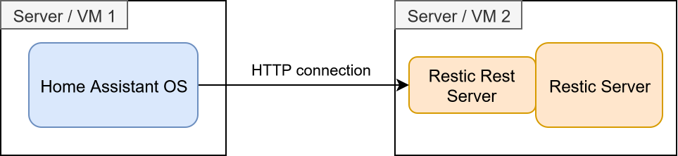

# Restic Backup for Home Assistant

This Home Assistant addon allows you to store your backups directly on a remote [restic](https://restic.net/) server via the 
[restic rest server](https://github.com/restic/rest-server). For security reasons it's assumed the `--append-only` flag is configured
and backup pruning is done by restic instead of HaOS. (Otherwise, an attacker that as access to your HaOS could delete all your backups)

This plugin assumes this network / server setup:

## Installation

Needs Home Assistant OS or Supervised, because the restic part runs as an add-on.

1. **Add-on**: add this repository to the Add-on Store, then install and start
   "Restic Restserver Backup".

   

2. **Integration**: install it with [HACS](https://hacs.xyz) (custom repository, category
   Integration), then restart Home Assistant.

   

3. **Set up**: add the integration and enter your details.

   

## Configuration

During installation you have to configure:

- **Server URL**: The URL + port + path to the restic repository on the restic rest server
- **Username**: Username for login on the rest server
- **Password**: Password to login on the rest server
- **Repo Password**: Restics repo password

## Features

- Backups appear as a normal backup location: create, list, download and restore from the Backups page.
- The restic repository is created on first use. A wrong password or server URL is an
  error and never creates a second repository.
- Browsing backups doesn't wake the repository's disk: they are listed from an index kept by the
  add-on. Home Assistant only contacts the repository for uploads, downloads and syncs.
- A backup is only stored if all of its bytes arrive. A broken upload leaves no snapshot behind.
- Deleting is disabled: Home Assistant can't remove backups from restic (a toast says so).
  Prune on the restic side instead.
- After each backup, and with the device's "Sync with repository" button, backups you pruned in
  restic are removed from the list. If the add-on's data is ever lost, the list is rebuilt from the repository.
- Failed downloads show an error toast.
- No port is opened on your network. Only Home Assistant talks to the add-on.

## Development

Open the folder in VS Code and "Reopen in Container" (installs Home Assistant and restic), then run
`scripts/develop`. It starts the add-on's `server.py` next to Home Assistant (port 8123) and
points the integration at it, so no HAOS is needed. Add the integration in the UI, pointed at a
real rest-server. Changes to either part take effect after restarting `scripts/develop`.

- Breakpoints: add `debugpy: {start: true, wait: true}` to `config/configuration.yaml` and use
  the "Python: Attach to Home Assistant" launch config.
- The full add-on lifecycle (s6, `rootfs/`, Supervisor) can be tried by copying `addon/restic_backup/`
  to `/addons/` on HAOS and installing it from "Local add-ons".
- Layout: `custom_components/restic_backup` is the integration, `addon/restic_backup` the add-on.
